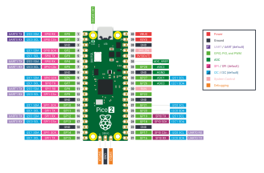
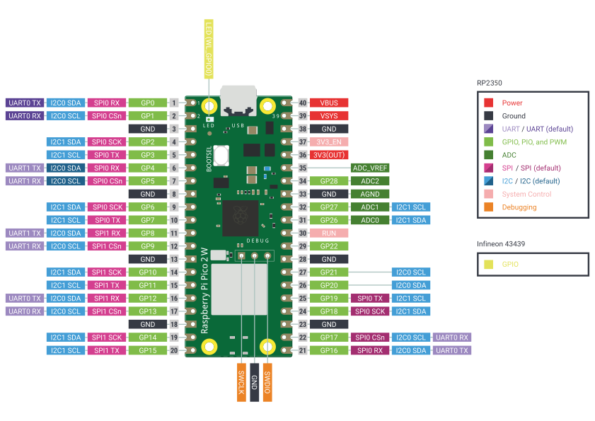

# pico2-rust-quickstart

A template for writing Rust for the RISC-V cores of the [Raspberry Pi Pico 2 and Pico 2 W](https://www.raspberrypi.com/documentation/microcontrollers/pico-series.html#pico-2-family). It can be adapted for other RP2350 based boards.

<center>
    <a href="https://github.com/raspberrypi/documentation/blob/master/documentation/asciidoc/microcontrollers/pico-series/images/pico-2-r4-pinout.svg">
        
    </a>
    <a href="https://github.com/raspberrypi/documentation/blob/master/documentation/asciidoc/microcontrollers/pico-series/images/pico2w-pinout.svg">
        
    </a>
</center>

The Pico 2 is built around the RP2350, which has two Hazard3 RISC-V cores running at up to 150 MHz and 520 KB of RAM. The Pico 2 W adds a CYW43439 radio for Wi-Fi and Bluetooth.

## Getting started

All you need is the board and a USB cable. The steps below take you through the prerequisites and how to get log output in your terminal.

### 1. Install the tools

Install Rust with [rustup](https://rustup.rs/). The toolchain and the `riscv32imac-unknown-none-elf` target are pinned in `rust-toolchain.toml`, so Cargo fetches them by itself on the first build.

Install [picotool](https://github.com/raspberrypi/picotool) version 2.0 or newer.
Note, if on Linux, your distro package manager may have it (make sure to check it's 2.0 or newer). Check which version you have with:

```sh
picotool version
```

Install a serial terminal to read the logs. Any one will do; these steps show [tio](https://github.com/tio/tio) and [picocom](https://github.com/npat-efault/picocom), which are packaged for most Linux distributions and for macOS through Homebrew. On Windows, you can use PuTTY.

### 2. Give your user access to the board (Linux only)

Install the udev rules that let `picotool` reach the board without root, then load them:

```sh
sudo cp support/60-picotool.rules /etc/udev/rules.d/
sudo udevadm control --reload
sudo udevadm trigger
```

Then add yourself to the group that owns serial ports. It is `dialout` on Debian, Ubuntu and Fedora, and `uucp` on Arch:

```sh
sudo usermod -aG dialout $USER   # or: sudo usermod -aG uucp $USER
```

Log out and back in for the new group to take effect.

### 3. Flash the board

The first time only, put the board in BOOTSEL mode: hold down the BOOTSEL button while you plug it into USB, then let go.

Then build and flash in one step. Each board has its own program, so pick yours:

```sh
cargo run --release --bin pico2    # Pico 2: blinks the LED
cargo run --release --bin pico2w   # Pico 2 W: scans for Wi-Fi networks
```

The two are not interchangeable. On the Pico 2 W the LED is wired to the radio, and the pin the Pico 2 uses for its LED talks to the radio instead.

`cargo run` builds the firmware, loads it with `picotool`, and starts it. The Pico 2 W program includes the radio's firmware, so it takes longer to flash.

### 4. Read the logs

The running board appears as a USB serial port: `/dev/ttyACM0` on Linux, and `/dev/cu.usbmodem` followed by a number on macOS. Open it with your terminal:

```sh
tio /dev/ttyACM0        # quit with Ctrl-t q
picocom /dev/ttyACM0    # quit with Ctrl-a Ctrl-x
```

On Linux, no `sudo` is needed once step 2 is done.
On Windows, find the board's COM port in Device Manager under "Ports (COM & LPT)" and open it in PuTTY as a serial connection.

The baud rate and the other serial settings make no difference, because the data travels over USB at USB speed whatever they are set to.

You should see `Hello, RISC-V Ottawa!` once a second. On the Pico 2 the LED blinks.
On the Pico 2 W the LED lights while a Wi-Fi scan runs, every ten seconds, and each network found is logged with its name, signal strength and channel.

> NOTE: on the the Pico 2 W, you may also see two `BDC event` warnings from the radio driver as it starts; they are [expected and harmless](https://github.com/embassy-rs/embassy/issues/3694).

### 5. Make a change and reflash

Edit `src/bin/pico2.rs` or `src/bin/pico2w.rs` and run the same `cargo run` command again. On Linux and macOS there is no need to touch the button: `picotool` asks the running firmware to reboot the board into BOOTSEL, then loads and starts the new image.

On Windows, the running firmware does not yet tell Windows which driver to use for that reboot request, so put the board in BOOTSEL mode by hand each time, as in step 3.

## Good to know

The log level is set where each program calls `usb_log::init`. It defaults to `Info`; change it to `Debug` or `Trace` for more output.

If the firmware panics, the message is logged and the board keeps its USB port alive, so you can read the message and reflash without touching the button.

Output waits on the board until a terminal reads it, so you can open the port after flashing without missing anything.
Up to 1 KiB is held; once that fills, new lines are dropped rather than slowing the firmware down.

To build without flashing, use `cargo build --release`, which builds both programs.

The firmware blobs in `cyw43-firmware/` are distributed under Infineon's permissive binary license; see the README in that directory.

For more examples, see the [rp235x-hal examples](https://github.com/rp-rs/rp-hal/tree/main/rp235x-hal-examples).
The ones listed in its `riscv_examples.txt` run on the RISC-V cores.

## Using a debug probe (optional)

A [Raspberry Pi Debug Probe](https://www.raspberrypi.com/documentation/microcontrollers/debug-probe.html), or a second Pico running the debugprobe firmware, can connect to the RP2350's SWD port. This allows for setting breakpoints, and logging over RTT.

1. Install probe-rs. Support for the RP2350's RISC-V cores landed very recently, so for now you need to install it from git from the commit that added support:

   ```sh
   cargo install probe-rs-tools --git https://github.com/probe-rs/probe-rs --rev 2bfe7e3d32c5cb3ac7cad041800bd8b220a28c54 --locked
   ```

   Once a release newer than v0.32.0 is out, a regular [probe-rs install](https://probe.rs/docs/getting-started/installation/) will do.

2. On Linux, install the probe's udev rules:

   ```sh
   sudo cp support/69-probe-rs.rules /etc/udev/rules.d/
   sudo udevadm control --reload
   sudo udevadm trigger
   ```

3. Wire the probe's `D` connector to the board's three SWD pins: SWCLK, GND and SWDIO. On the Pico 2 they are the three holes at the end of the board opposite the USB connector. On the Pico 2 W that end holds the antenna, so the same three holes, labelled DEBUG, sit just inboard of it. Neither board ships with pins fitted, so solder on a 3-pin header and use the probe's JST to header cable.

4. Plug the probe's USB port into your computer, power the Pico from its own USB port, and flash with the `run-probe` alias. It streams the same log output over RTT:

   ```sh
   cargo run-probe --release --bin pico2    # Pico 2
   cargo run-probe --release --bin pico2w   # Pico 2 W
   ```

## How it works

The template is built on these crates and tools:

- [rp235x-hal](https://docs.rs/rp235x-hal) is the `no_std` hardware abstraction layer for the RP2350, and the one that supports the RISC-V cores. It gives you safe access to peripherals such as GPIO, timers, PIO, SPI, and I2C, and routes interrupts through the Hazard3 interrupt controller.
- [embassy](https://embassy.dev/) provides the async runtime. The `embassy-executor` schedules async tasks and `embassy-time` supplies timers and delays, which lets you write concurrent firmware without an RTOS of your own.
- [cyw43](https://docs.rs/cyw43) drives the Pico 2 W's radio, which also controls that board's LED.
- [log](https://docs.rs/log) is the logging facade. `usb-device` and `usbd-serial` carry the output over the board's own USB port, and `rtt-target` copies it to RTT for when a debug probe is attached.
- [picotool](https://github.com/raspberrypi/picotool) loads firmware over USB and is what `cargo run` invokes to flash the board.
- [probe-rs](https://probe.rs/) programs and debugs the microcontroller over a debug probe, if you have one.

[Hazard3](https://github.com/Wren6991/Hazard3) implements the RV32IMAC instruction set plus the Zba, Zbb, Zbs and Zbkb bit-manipulation extensions and the Zcb and Zcmp compressed-instruction extensions. The RP2350 also contains a pair of Arm cores, and the boot ROM decides which architecture to start by reading a block at the front of the firmware image. Each program places that block (`IMAGE_DEF`), and because it is compiled for `riscv32imac-unknown-none-elf` it tells the boot ROM to start RISC-V.

Embassy's own RP2350 support (`embassy-rp`, and `cyw43-pio` on top of it) only targets the Arm cores, so two modules fill the gap for RISC-V:

- `src/time_driver.rs` is the `embassy-time` driver. It counts microseconds on `TIMER0` and uses an alarm interrupt to wake the executor when a timer expires.
- `src/cyw43_bus.rs` is the bus to the Pico 2 W's radio. The radio uses a single data line for both directions, so a PIO state machine clocks commands out and responses back in on the same pin, with the CPU feeding the PIO instead of DMA.

`src/wifi.rs` follows embassy's [`blinky_wifi.rs`](https://github.com/embassy-rs/embassy/blob/main/examples/rp235x/src/bin/blinky_wifi.rs) example step for step: the same pins, firmware files and clock divider, and the same order of `cyw43` calls.

`src/usb_log.rs` presents the board as Raspberry Pi's standard USB serial device and includes the small reset interface the Pico SDK uses. That interface is what `picotool load -f` looks for to reboot a running board into BOOTSEL.

## Resources

- Development board-specific resources
  - [Pico-series documentation](https://www.raspberrypi.com/documentation/microcontrollers/pico-series.html)
  - [Pico 2 Datasheet](https://datasheets.raspberrypi.com/pico/pico-2-datasheet.pdf)
  - [Pico 2 W Datasheet](https://datasheets.raspberrypi.com/picow/pico-2-w-datasheet.pdf)
  - [RP2350 Datasheet](https://datasheets.raspberrypi.com/rp2350/rp2350-datasheet.pdf), whose section 3.8 covers the Hazard3 cores
  - [Pico 2 Pinout](https://datasheets.raspberrypi.com/pico/Pico-2-Pinout.pdf)
  - [Pico 2 W Pinout](https://datasheets.raspberrypi.com/picow/pico-2-w-pinout.pdf)
  - [Raspberry Pi Debug Probe](https://www.raspberrypi.com/documentation/microcontrollers/debug-probe.html)
- [Hazard3 source and documentation](https://github.com/Wren6991/Hazard3)
- [The Embedded Rust Book](https://rust-embedded.github.io/book/)
- [Embassy Book](https://embassy.dev/book/)
- [rp-hal](https://github.com/rp-rs/rp-hal)
- [probe-rs](https://probe.rs/)
- [Awesome Embedded Rust](https://github.com/rust-embedded/awesome-embedded-rust)
